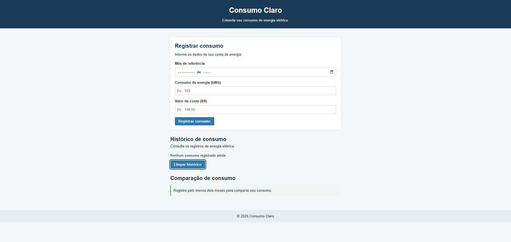
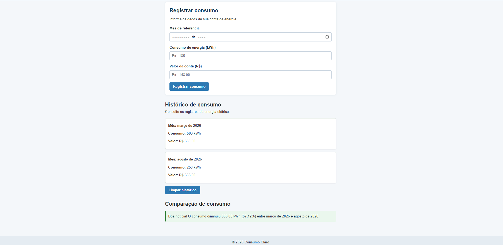
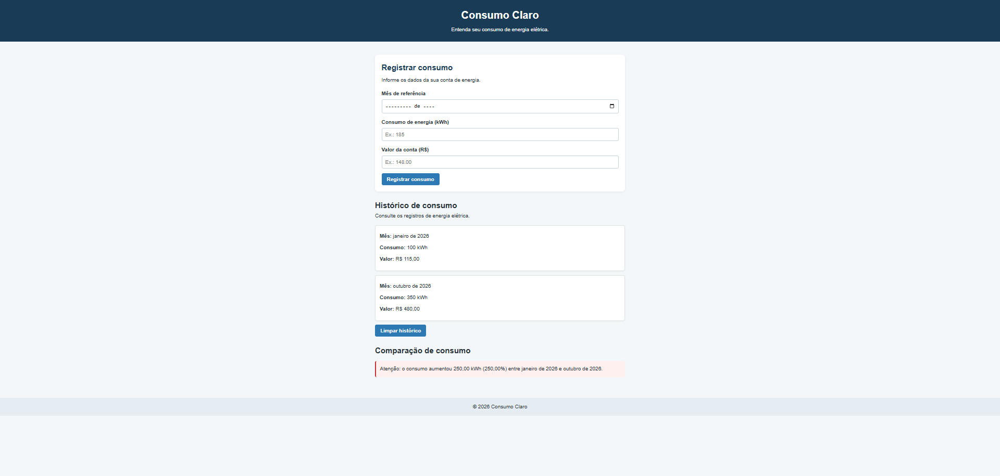
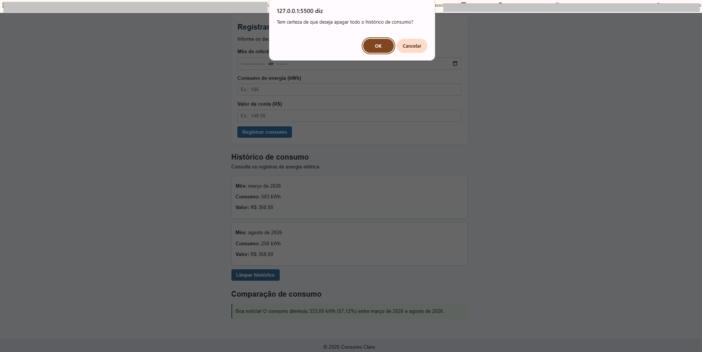

# Consumo Claro ⚡

Projeto web para registrar e acompanhar o consumo de energia elétrica, facilitando a comparação entre diferentes meses.

## 🌐 Acesse o projeto

[Consumo Claro — Site publicado](https://cristinamanganotti.github.io/consumo-claro/)

## 🎯 Objetivo

Desenvolver uma ferramenta simples e intuitiva para acompanhar o consumo mensal de energia elétrica e visualizar suas variações ao longo do tempo.

## ✨ Funcionalidades

- Cadastro do mês de referência, consumo em kWh e valor da conta.
- Validação dos dados informados.
- Prevenção de registros duplicados para o mesmo mês.
- Histórico de consumo organizado por mês.
- Comparação entre os dois últimos registros.
- Indicação de aumento, redução ou estabilidade do consumo.
- Armazenamento dos registros no navegador com `localStorage`.
- Opção para limpar o histórico.
- Layout adaptável a computadores e dispositivos móveis.

## 🛠️ Tecnologias utilizadas

- HTML5 — estrutura da página.
- CSS3 — aparência e organização visual.
- JavaScript — validações, cálculos e interações.
- LocalStorage — armazenamento dos registros no navegador.
- Git e GitHub — controle de versão e publicação.

## 📚 Aprendizados

Este projeto foi desenvolvido para praticar a construção de páginas web, a manipulação de elementos HTML com JavaScript, a validação de formulários, o armazenamento de dados no navegador e o uso do GitHub Pages para publicação.

## 👩‍💻 Autoria

Projeto pessoal desenvolvido para fins de aprendizado e composição de portfólio.

## 📸 Capturas de tela

### Formulário de cadastro

### Comparação de consumo

### Comparação de consumo

### Apagar histórico
